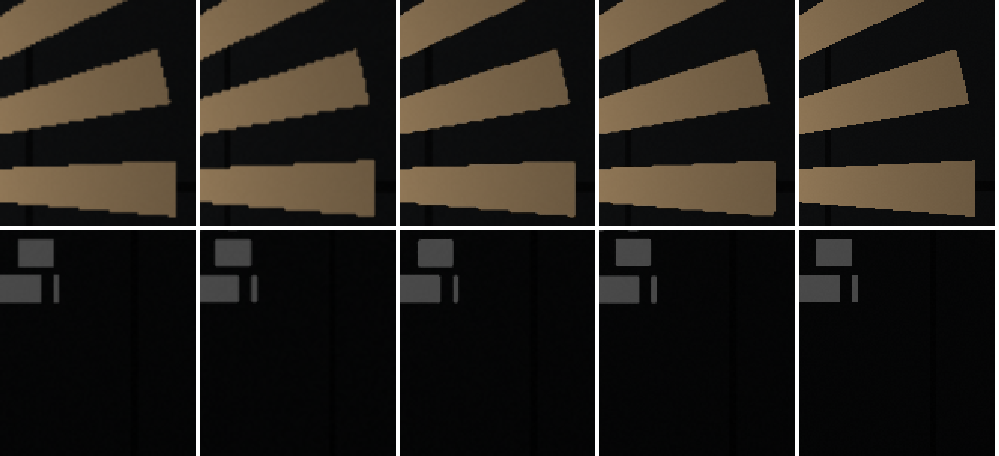

<p align="center">
  
</p>

<p align="center">
  <a href="LICENSE"></a>
  
  
</p>

# MABA Upscaler

A single-pass spatial upscaler built for low-end mobile GPUs. Render your game at a lower
resolution, and MABA upscales and sharpens it to the screen in one cheap fragment-shader pass.

Desktop-oriented upscalers such as FSR 1.0 can cost more than they save on entry-level phones.
On a Samsung Galaxy A05, FSR 1.0 took about 18 ms per frame more than a plain bilinear upscale,
which is more than a whole 60 fps frame. MABA's fast shader takes about 1 ms more.

- One fragment-shader pass. No compute shader, no intermediate render target.
- Half-precision maths; 2 texture reads per pixel in the fast build.
- Quality modes: **Dynamic** (default), Ultra Quality, Quality, Balanced, Performance.
- Dynamic mode adjusts render resolution and shader at runtime to hold a target frame rate,
  without ever reallocating a render target.
- Sharpening that cannot ring or overshoot, and that fades out in near-black areas so dark
  scenes do not get noisy.
- OpenGL ES 3.0, OpenGL ES 3.1+ and Vulkan from one GLSL source file.

## Results

Samsung Galaxy A05 (Mali-G52 MC2, OpenGL ES 3.2), output 1541x720. Measured off-screen so the
60 Hz display cap does not apply; range over two runs.

| Mode | Render scale | Frame time | FPS | vs native |
|---|---|---|---|---|
| Native resolution | 1.00 | 34.0 ms | 29.4 | - |
| Ultra Quality | 0.77 | 23.5 - 24.7 ms | 40.5 - 42.5 | +38 to +44% |
| Quality | 0.67 | 19.1 - 20.2 ms | 49.4 - 52.4 | +68 to +78% |
| Balanced | 0.59 | 15.8 - 16.9 ms | 59.1 - 63.2 | +101 to +115% |
| Performance | 0.50 | 10.2 - 11.2 ms | 89.5 - 98.2 | +204 to +234% |
| Plain bilinear, no MABA | 0.59 | 12.9 - 13.5 ms | 74.0 - 77.7 | +152 to +164% |

On screen, Dynamic mode settled on Balanced and held 58.6 - 60.1 fps (version 1.3 controller,
90-second runs, 2-second windows).

<p align="center">
  <br>
  <em>3x zoom. Left to right: bilinear 0.59, Performance, Balanced, Ultra Quality, native.</em>
</p>

**Read these numbers with care.** The test scene is a procedural pattern whose cost is entirely
per-pixel. A real game also has CPU, vertex and shadow costs that do not shrink with resolution,
so its gain over native will be smaller. Everything here was measured on one phone. MABA is a
spatial upscaler: it is sharper than bilinear and softer than native, and it does not add
anti-aliasing or temporal stability.

## Repository layout

```
src/
  maba_upscaler.frag.glsl   The upscaler (fast build and MABA_QUALITY build)
  maba_upscaler.vert.glsl   Full-screen triangle
  maba_upscaler.h           Quality modes and Dynamic controller (C99 / C++, header only)
test/android/               Benchmark app; builds without Gradle
assets/                     Logo and icon
docs/images/                Comparison screenshots
```

## Modes

| Mode | Render scale | Shader |
|---|---|---|
| **Dynamic** (default) | 0.50 - 0.77 | Moves between the levels below, plus 0.59 with the fast shader |
| Ultra Quality | 0.77 | quality |
| Quality | 0.67 | quality |
| Balanced | 0.59 | quality |
| Performance | 0.50 | fast |

**Dynamic** watches a smoothed frame time. If it stays more than 2% over the target for 20
frames, it steps down one level. After 180 good frames it tries one level up; if that attempt
fails, the wait before the next one doubles (up to 3600 frames), and relaxes again once a step up
has held for 300 frames.

## How the shader works

**Fast build.** For every output pixel it looks at the 2x2 block of input texels around it.

1. *Edge-directed interpolation.* The block is split into two triangles along whichever diagonal
   has less contrast, so a diagonal edge is followed instead of blurred across.
2. *Weight sharpening.* The interpolation weights are steepened, which narrows edges. The result
   always stays between the four source texels, so it cannot ring.
3. *Dark fade.* Sharpening fades out in near-black areas.

**Quality build** (`MABA_QUALITY 1`). Low-contrast pixels take the fast path at the same cost.
Pixels on visible edges fade in a 12-tap edge-adaptive kernel on luma, derived from FSR 1.0's
EASU, which follows the edge direction and removes most stair-stepping.

## Quick start

Neither shader has a `#version` line. Prepend one of these headers to **both** shaders, and build
the fragment shader twice: once as is (fast) and once with `#define MABA_QUALITY 1\n` added.

| Target | Header |
|---|---|
| OpenGL ES 3.1+ | `#version 310 es\n#define MABA_GATHER 1\n` |
| OpenGL ES 3.0 | `#version 300 es\n#define MABA_GATHER 0\n` (fast build only; use it for every level) |
| Vulkan | `#version 450\n#define MABA_VULKAN 1\n#define MABA_GATHER 1\n` |

Shader inputs:

| Name | Type | Value |
|---|---|---|
| `uMabaInput` | sampler2D | The low-resolution frame. LINEAR filter, CLAMP_TO_EDGE, no mipmaps. |
| `uMabaInputSize` | vec4 | `xy` = size in texels of the image region, `zw` = 1 / texture size. |
| `uMabaParams` | vec4 | `x` = sharpness, 0 to 1. Start at 0.5. `yzw` unused. |

On Vulkan the two vec4s are one push-constant block (32 bytes) and the sampler is set 0, binding 0.

```c
#include "maba_upscaler.h"

// Once
MabaUpscaler maba;
MabaInit(&maba, MABA_MODE_DYNAMIC, 60.0f);          // or MABA_MODE_QUALITY, _BALANCED, ...
int texW, texH;
MabaMaxRenderSize(outW, outH, &texW, &texH);        // allocate sceneTex at this size, once

// Every frame
MabaFrame f = MabaBeginFrame(&maba, lastFrameMs, outW, outH);

glBindFramebuffer(GL_FRAMEBUFFER, sceneFbo);
glViewport(0, 0, f.renderWidth, f.renderHeight);
RenderScene();

float size[4], params[4];
MabaUniforms(&f, texW, texH, 0.5f, size, params);
GLuint prog = f.qualityShader ? progQuality : progFast;
glBindFramebuffer(GL_FRAMEBUFFER, 0);
glViewport(0, 0, outW, outH);
glDisable(GL_DEPTH_TEST);
glDisable(GL_BLEND);
glUseProgram(prog);
glActiveTexture(GL_TEXTURE0);
glBindTexture(GL_TEXTURE_2D, sceneTex);
glUniform1i(glGetUniformLocation(prog, "uMabaInput"), 0);
glUniform4fv(glGetUniformLocation(prog, "uMabaInputSize"), 1, size);
glUniform4fv(glGetUniformLocation(prog, "uMabaParams"), 1, params);
glBindVertexArray(emptyVao);
glDrawArrays(GL_TRIANGLES, 0, 3);
RenderUI();                                         // at outW x outH

// To change mode from a settings menu:
MabaSetMode(&maba, MABA_MODE_PERFORMANCE);
```

`lastFrameMs` is the time the previous frame took, present to present, in milliseconds.

Requirements:

- The input must be the finished LDR image in a gamma / sRGB-encoded space (after tonemapping).
- The image region must start at texel (0,0) of the input texture.
- Render the UI after the upscale, at output resolution.
- If the image comes out upside down, flip `vMabaUV.y` in the vertex shader.

## Tuning

| Shader define | Default | Effect |
|---|---|---|
| `MABA_QUALITY` | `0` | `1` selects the adaptive edge kernel (needs `MABA_GATHER 1`). |
| `MABA_DARK_LO` / `MABA_DARK_HI` | `0.02` / `0.12` | Brightness range over which sharpening fades in. |
| `MABA_EDGE_LO` / `MABA_EDGE_HI` | `10/255` / `24/255` | Quality build: contrast range over which the kernel fades in. |

For the controller, edit the levels table `kMabaLevels` and the `MABA_DYN_*` constants in
`maba_upscaler.h`.

## Benchmark app

`test/android` is a small Android app that renders a test scene, measures every mode off-screen,
and lets you tap through the modes on screen. It builds with the Android SDK command-line tools:

```
powershell -ExecutionPolicy Bypass -File test\android\build.ps1 -Install
```

It needs the Android SDK, a JDK 11 or newer, and the Android debug keystore. Results go to logcat
under the tag `MABA`.

## Status and limitations

- Shaders compile with the Android NDK `glslc` for OpenGL ES 3.1 and Vulkan; the header compiles
  as C99 and C++.
- Run and measured on one device: Samsung Galaxy A05, OpenGL ES 3.2.
- Not yet run on Adreno or PowerVR GPUs, on an OpenGL ES 3.0-only device, or under Vulkan.
- The test app drives Dynamic mode with a Java port of the controller; the C header has been
  compiled but not executed.
- No engine plugins yet (Unity, Unreal). Integration is by hand, as in the quick start.

Reports from other devices are very welcome.

## Licence

MABA Upscaler is licensed under the [Apache License 2.0](LICENSE).
Copyright 2026 MABA Studios. MABA Studios is owned by Muhammad Affan Bin Adnan.

The quality build's kernel is derived from AMD FidelityFX Super Resolution 1.0, copyright
Advanced Micro Devices, Inc., under the MIT licence. See [NOTICE](NOTICE) and
[THIRD_PARTY_NOTICES.md](THIRD_PARTY_NOTICES.md); both must be kept with any redistribution.
MABA Upscaler is not affiliated with or endorsed by AMD.
